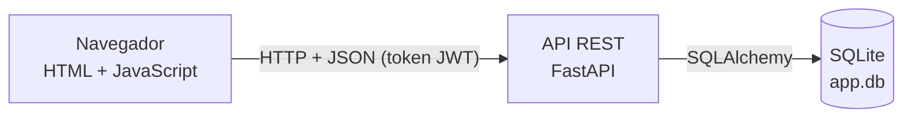
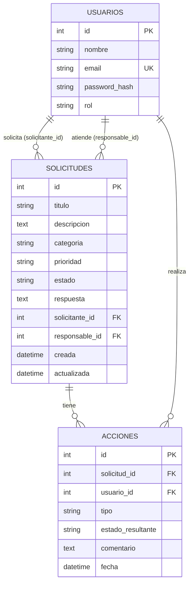
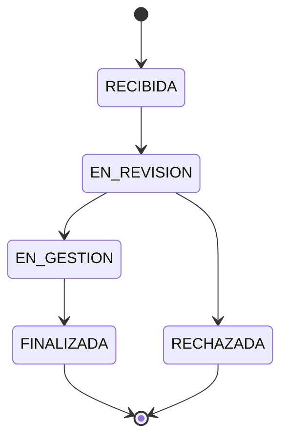

# Diseño — PF-01

## 1. Arquitectura cliente-servidor

| Componente | Tecnología | Responsabilidad |
|---|---|---|
| Frontend | HTML, CSS y JavaScript sin framework (`app/static/index.html`) | Mostrar datos, recibir acciones y llamar a la API con `fetch`. |
| Backend | Python + FastAPI | Autenticar, validar, aplicar reglas de negocio y exponer la API. |
| Persistencia | SQLite + SQLAlchemy | Guardar usuarios, solicitudes y acciones con llaves foráneas activas. |

**Por qué estas tecnologías:** FastAPI valida con Pydantic y genera la documentación interactiva (`/docs`); SQLite no necesita instalar un servidor; un solo servidor entrega la interfaz y la API, lo que simplifica ejecutar y evaluar.

**Organización del código**
```
app/
  main.py        arranque, tablas y rutas
  config.py      variables de entorno, estados y transiciones
  database.py    motor y sesión de SQLAlchemy
  models.py      tablas
  schemas.py     validación de entradas
  security.py    hash, JWT y control de roles
  routers/       auth.py · solicitudes.py · resumen.py
  static/        index.html (interfaz)
seed.py          datos ficticios
pruebas/         pruebas funcionales y capturas
```

## 2. Modelo de datos


## 3. Flujo de estados


## 4. Especificación de la API
| Método | Ruta | Quién | Éxito | Errores |
|---|---|---|---|---|
| POST | `/auth/registro` | Público | 201 | 409 correo repetido, 422 datos inválidos |
| POST | `/auth/login` | Público | 200 + token | 401 credenciales incorrectas |
| GET | `/auth/me` | Autenticado | 200 | 401 |
| POST | `/solicitudes` | Solicitante | 201 | 401, 403, 422 |
| GET | `/solicitudes?estado=` | Autenticado (solicitante: solo las suyas) | 200 | 401, 422 |
| GET | `/solicitudes/{id}` | Autenticado | 200 | 401, 403 ajena, 404 |
| GET | `/solicitudes/{id}/historial` | Autenticado | 200 | 401, 403, 404 |
| POST | `/solicitudes/{id}/acciones` | Personal, coordinación | 201 | 403, 404, 409 transición inválida o cerrada, 422 |
| GET | `/resumen` | Coordinación | 200 | 401, 403 |
| GET | `/meta` | Público | 200 | — |

Ejemplo de solicitud para gestionar:
```json
POST /solicitudes/4/acciones
{ "comentario": "Documento emitido", "estado_nuevo": "FINALIZADA", "respuesta": "Tu paz y salvo fue enviado a tu correo." }
```

## 5. Reglas de negocio y permisos
Las reglas RN-01 a RN-05 de `docs/requisitos.md` se aplican en `routers/solicitudes.py`; los permisos por rol en `security.requiere_roles`. La interfaz solo muestra opciones coherentes, pero **la validación real está en el servidor**.

## 6. Interfaz
Pantalla única con acceso (login/registro) y dos columnas: lista de solicitudes con filtro por estado y detalle con historial. Según el rol aparece el formulario de nueva solicitud, el panel de gestión o el resumen de coordinación. Capturas en `evidencias/ui_*.png`.

## 7. Decisiones técnicas
| Decisión | Motivo |
|---|---|
| Tabla `acciones` separada | Da trazabilidad (CA-04): cada intervención queda como un registro. |
| Transiciones definidas en `config.py` | Una sola fuente de verdad para API e interfaz (`/meta`). |
| JWT con vencimiento de 8 horas | Sesión sin estado en el servidor. |
| Llaves foráneas activadas en SQLite | SQLite las ignora por defecto; sin ellas no hay integridad. |
| La interfaz construye el DOM sin `innerHTML` con datos del usuario | Evita inyección de código (XSS). |
